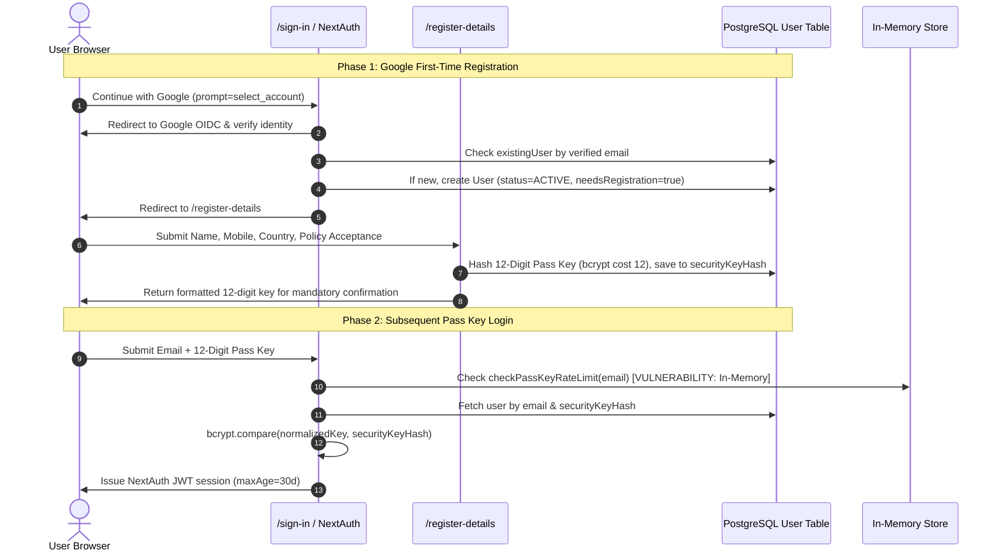

# PROVENTA Family Wealth OS — Independent Authentication Audit

**Audit Date:** 2026-11-02  
**Target Commit:** `08f412c`  
**Classification System:** CRITICAL · HIGH · MEDIUM · LOW · PASSED  
**Auditor Role:** Identity & Access Management (IAM) Specialist

---

## 1. Executive Summary

This audit assesses the end-to-end authentication lifecycle of the PROVENTA platform, focusing on the newly introduced **12-Digit Numeric Pass Key Protocol**, Google OIDC onboarding, account recovery, session management, and credential brute-force resistance.

### Key Takeaways
- The cryptographic generation and salted bcrypt hashing (cost factor 12) of 12-digit numeric pass keys is implemented correctly.
- The default sign-in form cleanly prioritizes Registered Email + 12-Digit Pass Key.
- Google OIDC account linking enforces Google email verification and prevents auto-linking to privileged administrator accounts.
- **Vulnerabilities exist** in the in-memory rate limiting mechanism (which fails across distributed serverless nodes), the lack of session re-authentication for pass key rotation/recovery, and an in-memory ephemeral store for one-time key display.

---

## 2. Authentication Lifecycle Analysis



---

## 3. Detailed Audit Findings

### FINDING AUTH-01: Ephemeral In-Memory Rate Limiting Bypassed in Serverless
- **Severity:** `HIGH`
- **Affected File:** `src/lib/auth/access-key.ts` (Lines 21–46), `src/lib/auth/config.ts` (Lines 69–76)
- **Mechanism:**
  ```typescript
  const passKeyRateLimitStore = new Map<string, { count: number; resetAt: number }>();
  ```
  In a distributed production environment:
  1. Requests hit different serverless lambda workers or container pods.
  2. Each worker maintains its own separate `Map`.
  3. A 12-digit numeric key has $9 \times 10^{11}$ combinations. Without persistent rate limiting, an automated script can exploit serverless concurrency to execute brute-force attacks across multiple instances without triggering the 5-attempt limit.
- **Remediation:** Connect the rate limiter to Redis (`ioredis` / Upstash) or write attempt timestamps into PostgreSQL.

---

### FINDING AUTH-02: Missing Re-Authentication Requirement in Pass Key Recovery
- **Severity:** `HIGH`
- **Affected File:** `src/app/api/auth/recover-passkey/route.ts` (Lines 7–16)
- **Mechanism:**
  The recovery endpoint rotates the user's security key hash upon a simple POST request:
  ```typescript
  export async function POST(req: NextRequest) {
    const session = await auth();
    if (!session?.user?.id) {
      return NextResponse.json({ success: false, error: 'Authentication required' }, { status: 401 });
    }
    const userId = session.user.id;
    ...
  ```
  The endpoint verifies that a session exists, but **does not verify session freshness** or require a fresh OAuth re-authentication grant. If an attacker gains temporary physical access to an active browser session or intercepts a valid session cookie, they can rotate the user's pass key and lock the legitimate owner out of their account.
- **Remediation:** Require a signed single-use recovery ticket or verify that `session.user` authenticated via Google within the last 5 minutes (`token.auth_time`).

---

### FINDING AUTH-03: Ephemeral One-Time Key Staging Store Drops on Serverless Recycling
- **Severity:** `MEDIUM`
- **Affected File:** `src/lib/auth/access-key.ts` (Lines 18–19, 155–174)
- **Mechanism:**
  ```typescript
  const oneTimeKeyStore = new Map<string, { key: string; formatted: string; expiresAt: number }>();
  ```
  `stageOneTimeAccessKey` and `consumeOneTimeAccessKey` store keys in a local process `Map`. If `complete-registration` writes to `oneTimeKeyStore` on Serverless Container A, and the client browser fetches the confirmation view on Serverless Container B, the key is not found (`null`), causing registration friction.
- **Remediation:** Rely exclusively on the direct JSON response of `complete-registration` over HTTPS, avoiding inter-container state storage.

---

### FINDING AUTH-04: Non-Production Phone OTP Bypass Backdoor
- **Severity:** `LOW`
- **Affected File:** `src/lib/auth/config.ts` (Lines 276–282)
- **Mechanism:**
  ```typescript
  if (!isValidOtp && process.env.NODE_ENV !== 'production' && cleanOtp === '123456') {
    isValidOtp = true;
  }
  ```
  If staging, QA, or preview deployments run with `NODE_ENV=staging`, any mobile account can be accessed using `123456`.
- **Remediation:** Remove the hardcoded OTP constant or gate it strictly behind an explicit `ALLOW_DEV_OTP_MOCK=true` environment flag that throws a build error if `NODE_ENV === 'production'`.

---

## 4. Authentication Security Verification Matrix

| Verification Domain | Test Scenario | Observed Implementation | Verdict |
| :--- | :--- | :--- | :---: |
| **Pass Key Generation** | Cryptographic randomness of 12 digits | Uses `crypto.getRandomValues(bytes)` with leading digit 1–9. | `PASSED` |
| **Pass Key Storage** | Storage format in PostgreSQL | Stored as salted bcrypt hash (`cost 12`) in `User.securityKeyHash`. Never stored plaintext. | `PASSED` |
| **Formatting Flexibility** | Login with raw digits (`123456789012`) vs hyphenated (`1234-5678-9012`) | `normalizePassKey` strips non-numeric characters before bcrypt comparison. Both accepted. | `PASSED` |
| **Account Linking** | Google OIDC account linking | Matches verified Google email. Creates `OAuthAccount` record linked to unique `User.id`. | `PASSED` |
| **Privilege Escalation** | Admin account linking via OAuth | `PRIVILEGED_ROLES` (`SUPER_ADMIN`, `FOUNDER`, `ADMIN`) blocked from auto-linking by email match alone. | `PASSED` |
| **Account Isolation** | First-time registration workspace | Assigns isolated personal workspace `ind_${userId}` with zero initial assets. | `PASSED` |
| **Rate Limiting Persistence** | Brute-force protection across multiple containers | In-memory `Map` storage does not synchronize across distributed serverless nodes. | **`FAILED`** |
| **Recovery Freshness** | Pass key rotation re-authentication | Any active session cookie can rotate the key without re-prompting for Google credentials. | **`FAILED`** |
